# 📊 Student Performance Analysis

### Data Analytics Internship Project

A Python-based Exploratory Data Analysis (EDA) project focused on analyzing student academic performance using Mathematics and Portuguese student datasets.

The project explores academic results, study habits, attendance, previous failures, parental education and other factors to identify meaningful patterns through statistical analysis and data visualization.

---

## 🎯 Project Objectives

- Understand and explore student datasets.
- Perform data cleaning and preprocessing.
- Identify missing values and duplicate records.
- Calculate average academic grades.
- Compare Mathematics and Portuguese performance.
- Analyze gender-wise academic performance.
- Investigate the relationship between study time and grades.
- Analyze the impact of previous academic failures.
- Examine attendance and parental education patterns.
- Perform correlation analysis.
- Create meaningful data visualizations.
- Generate actionable analytical insights.

---

## 🛠️ Technologies Used

| Technology | Purpose |
|---|---|
| Python | Programming |
| Pandas | Data manipulation and analysis |
| NumPy | Numerical computation |
| Matplotlib | Data visualization |
| Seaborn | Statistical visualization |
| Jupyter Notebook | Interactive analysis |
| VS Code | Development environment |

---

## 📁 Project Structure

```text
Student-Performance-Analysis/
│
├── dataset/
│   ├── student-mat.csv
│   └── student-por.csv
│
├── notebooks/
│   └── Student_Performance_Analysis.ipynb
│
├── reports/
│   └── Student_Performance_Analysis_Report.md
│
├── visualizations/
│   ├── absence_analysis.png
│   ├── correlation_heatmap.png
│   ├── father_education.png
│   ├── gender_performance.png
│   ├── mathematics_distribution.png
│   ├── mother_education.png
│   ├── pass_fail_analysis.png
│   ├── performance_distribution.png
│   ├── portuguese_distribution.png
│   ├── previous_failures.png
│   ├── study_time_analysis.png
│   └── subject_comparison.png
│
├── README.md
├── requirements.txt
└── .gitignore
```

---

## 📊 Dataset Information

Two datasets were used for this analysis.

| Dataset | Records | Features |
|---|---:|---:|
| Mathematics | 395 | 33 |
| Portuguese | 649 | 33 |

### Important Features

| Feature | Description |
|---|---|
| school | Student's school |
| sex | Gender |
| age | Student's age |
| address | Urban or rural residence |
| Medu | Mother's education |
| Fedu | Father's education |
| studytime | Weekly study time |
| failures | Previous class failures |
| absences | Number of absences |
| G1 | First-period grade |
| G2 | Second-period grade |
| G3 | Final grade |

The final grades range from 0 to 20.

---

## 🔍 Data Analysis Performed

### 1. Data Cleaning and Inspection

- Dataset shape and structure inspection.
- Data type identification.
- Missing-value detection.
- Duplicate-record detection.
- Numerical and categorical feature identification.

### 2. Exploratory Data Analysis

- Subject-wise average grade comparison.
- Gender-wise academic performance.
- Study time vs final grades.
- Absences vs academic performance.
- Student performance classification.
- Previous failures analysis.
- Mother's and father's education analysis.

### 3. Statistical Analysis

- Mean, median, minimum and maximum.
- Pass/fail distribution.
- Performance group distribution.
- Correlation analysis.
- Feature relationship investigation.

---

## 📈 Key Findings

### Subject Performance

| Subject | Average Final Grade |
|---|---:|
| Mathematics | 10.42 |
| Portuguese | 11.91 |

Portuguese students achieved a higher average final grade in the analyzed datasets.

### Mathematics Pass/Fail Analysis

Using 10/20 as the project's analytical passing threshold:

| Result | Students | Percentage |
|---|---:|---:|
| Pass | 265 | 67.09% |
| Fail | 130 | 32.91% |

### Student Performance Distribution

| Category | Students | Percentage |
|---|---:|---:|
| Low | 130 | 32.91% |
| Medium | 192 | 48.61% |
| High | 73 | 18.48% |

### Correlation Analysis

| Variables | Correlation |
|---|---:|
| G1 and G3 | 0.801 |
| G2 and G3 | 0.905 |
| Failures and G3 | -0.360 |
| Studytime and G3 | 0.098 |
| Absences and G3 | 0.034 |

**Important observations:**

- Previous examination grades show strong positive correlations with final grades.
- Previous academic failures show a negative relationship with final grades.
- Study time has a weak positive linear relationship with final grades.
- Absences show almost no linear correlation with final grades.

Correlation does not imply causation.

---

## 📊 Data Visualizations

The project contains 12 visualizations.

### 1. Pass/Fail Analysis

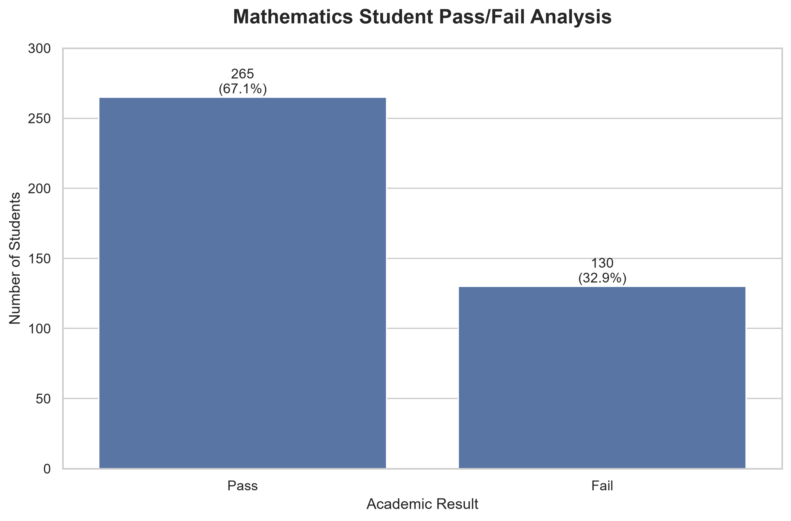

### 2. Subject Comparison

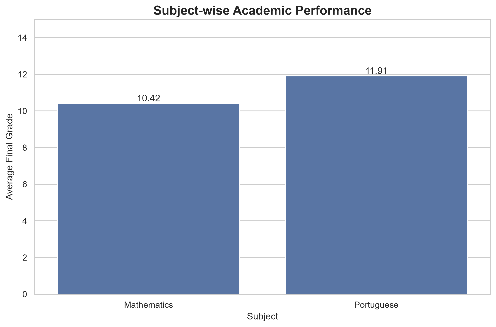

### 3. Gender-wise Performance

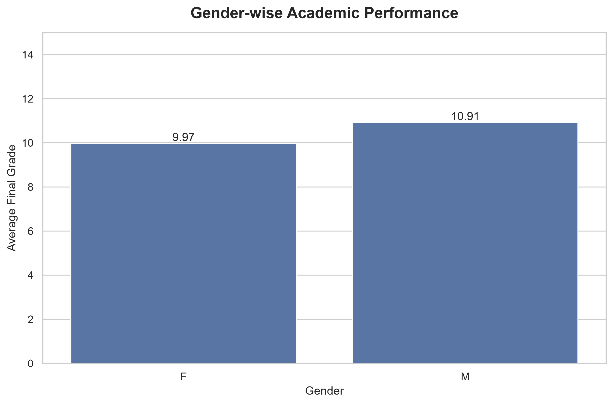

### 4. Study Time Analysis

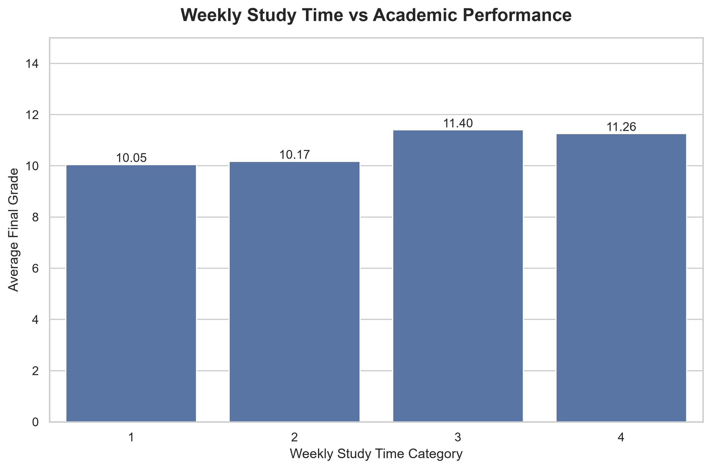

### 5. Absence Analysis

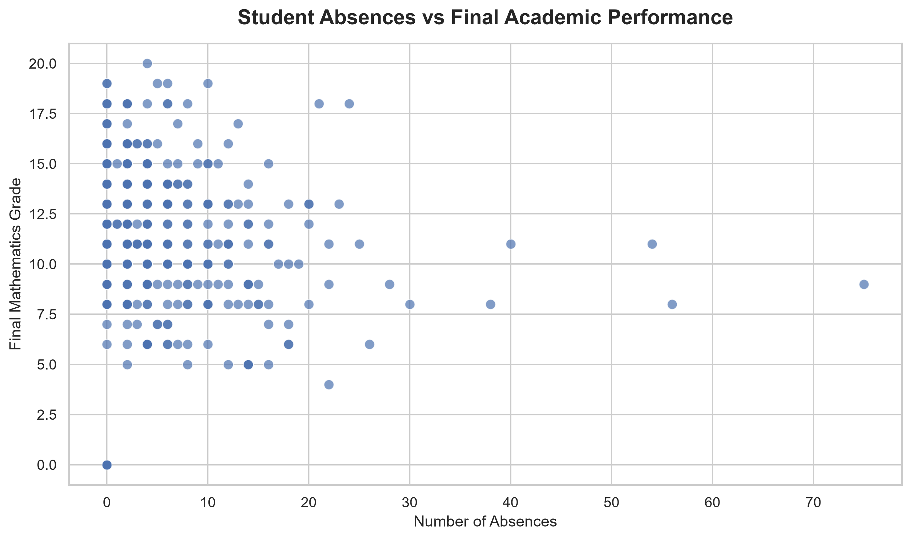

### 6. Performance Distribution

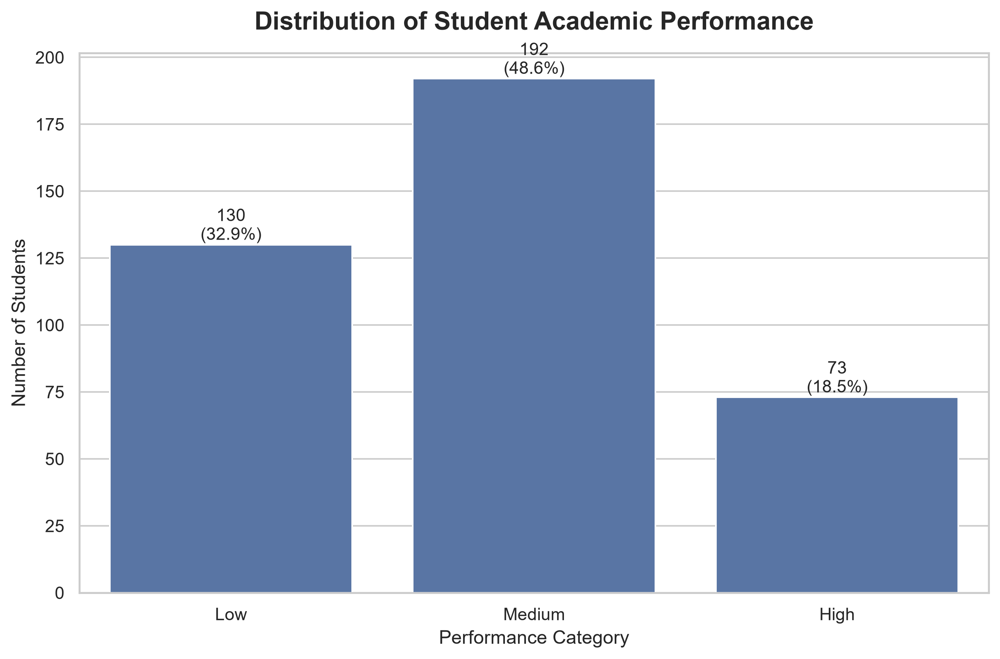

### 7. Mathematics Grade Distribution

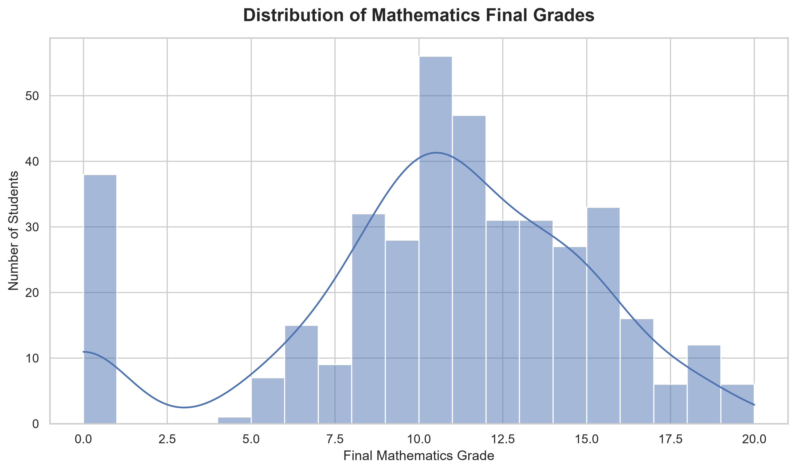

### 8. Portuguese Grade Distribution

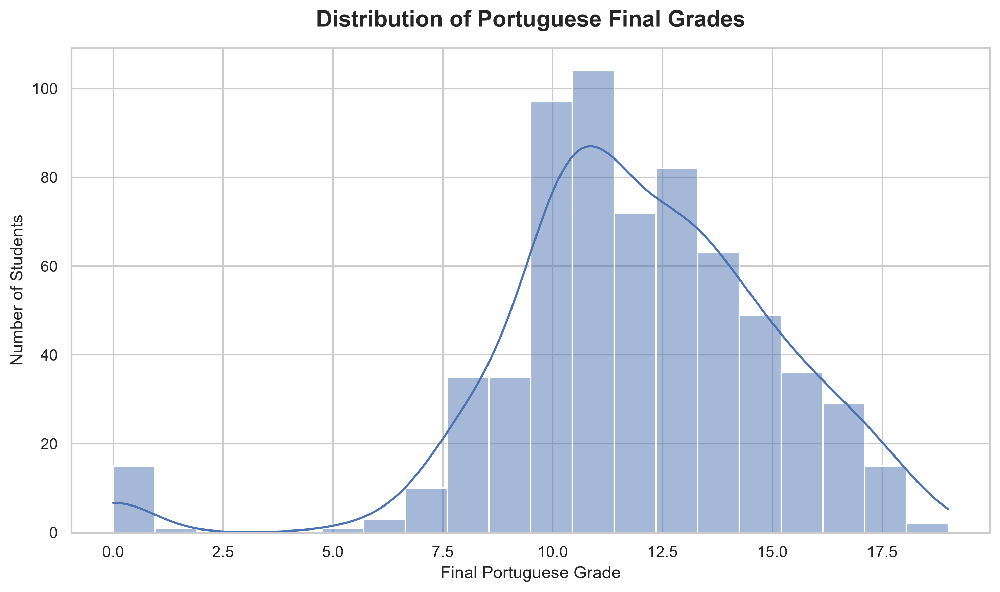

### 9. Correlation Heatmap

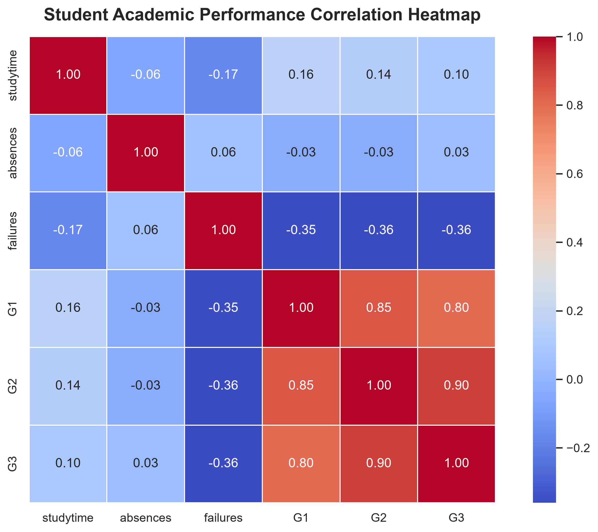

### 10. Previous Failures Analysis

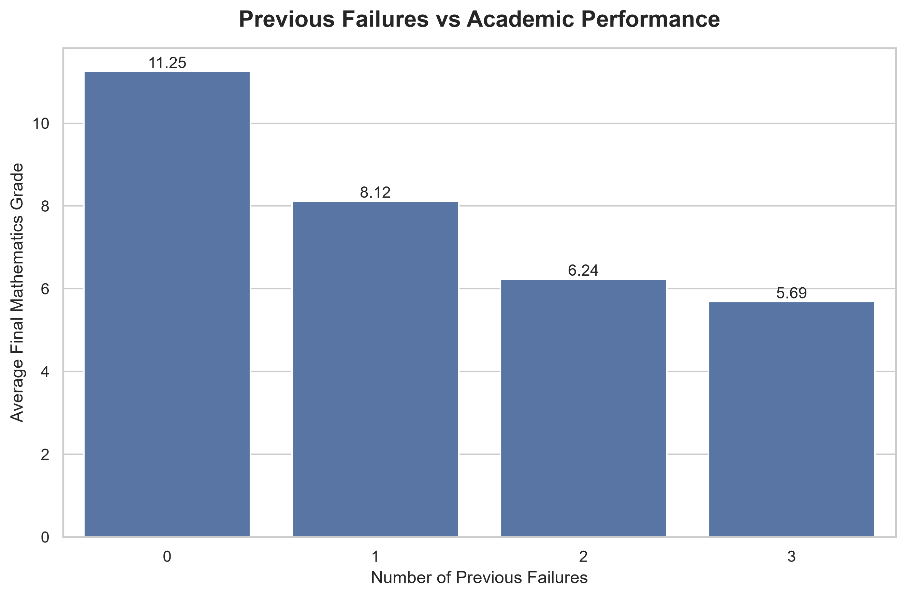

### 11. Mother's Education Analysis

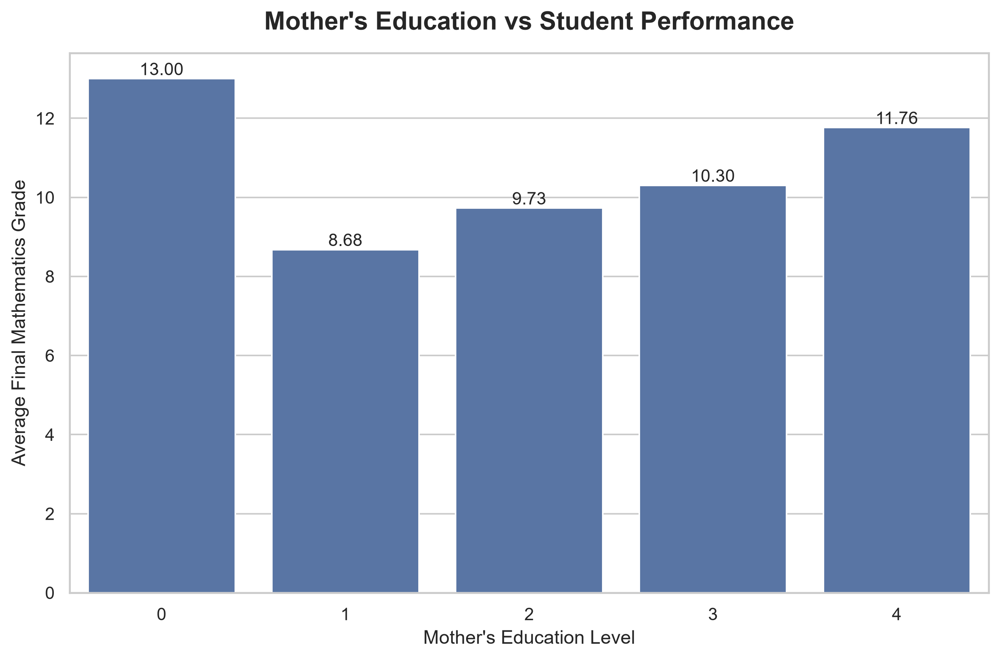

### 12. Father's Education Analysis

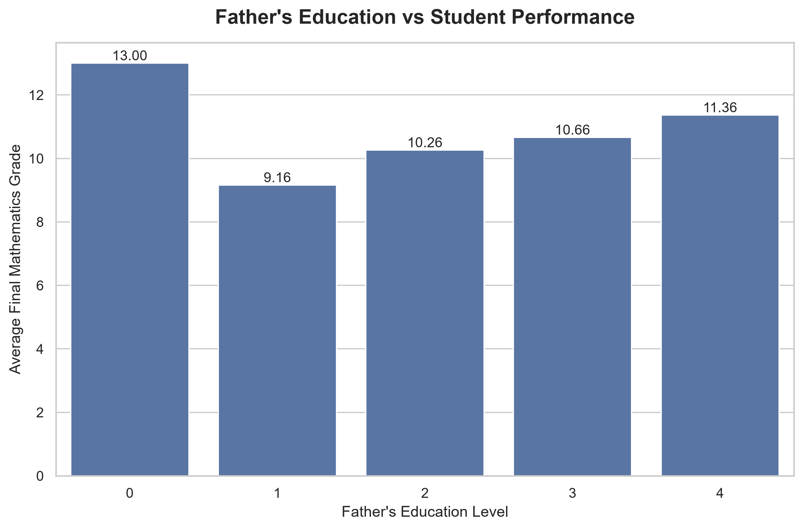

---

## ⚙️ Installation and Usage

### Step 1: Clone the Repository

```bash
git clone YOUR_GITHUB_REPOSITORY_URL
```

### Step 2: Navigate to the Project

```bash
cd Student-Performance-Analysis
```

### Step 3: Create a Virtual Environment

```bash
python -m venv .venv
```

### Step 4: Activate the Environment

**Windows:**

```powershell
.venv\Scripts\activate
```

### Step 5: Install Dependencies

```bash
pip install -r requirements.txt
```

### Step 6: Launch Jupyter Notebook

```bash
jupyter notebook
```

Open:

```text
notebooks/Student_Performance_Analysis.ipynb
```

Run the notebook cells to reproduce the analysis.

---

## 📄 Project Report

The detailed project report is available here:

`reports/Student_Performance_Analysis_Report.md`

It contains the project introduction, objectives, methodology, statistical findings, visualizations, recommendations and conclusion.

---

## ⚠️ Limitations

- The analysis is based on the available dataset features.
- The two subject datasets contain different numbers of records.
- Correlation does not establish causation.
- The
